# The flick brand

One identity for the whole family: **flick** (this umbrella),
[flick-backend](https://github.com/one-more-refactor/flick-backend),
[flick-web](https://github.com/one-more-refactor/flick-web),
[flick-admin](https://github.com/one-more-refactor/flick-admin) and
[flick-tui](https://github.com/one-more-refactor/flick-tui). This page is the
reference for the READMEs and marketing surfaces of all five. The app UI follows
the binding design tokens in [CONTRACTS.md → Design tokens](CONTRACTS.md#design-tokens-websrcappcss-is-the-shipped-implementation).
If this page and the contract disagree, the contract wins.

<p align="center"><picture>
  <source media="(prefers-color-scheme: dark)" srcset="../.github/brand/wordmark-dark.svg">
  
</picture></p>

## The idea

flick shows you one word at a time and pins one letter (the **pivot**, or
optimal recognition point) in place so your eyes can stay still. The brand is
that same picture: guide rails, two accent notches, one red letter.

- **Name:** `flick` in prose, always lowercase. `FLICK_` (caps, trailing
  cursor) is the wordmark and the app header. Sibling repos are `flick-<part>`,
  and their headings read `FLICK_ <sub>part</sub>`.
- **Tagline:** *read it in a flick.*
- **One-liner:** self-hosted speed reading for PDFs, EPUBs and your
  read-later pile.
- **Voice:** short, plain, a little dry. Make claims you can back up, and say
  the honest part out loud (RSVP takes away eye movement. It doesn't make you
  pay more attention). No hype words and no exclamation marks.

## Palette

Neutrals are warm, and there's **one accent**. Red is the default `paper`
theme. The other five themes swap the accent and nothing else.

| role | light | dark | used for |
|---|---|---|---|
| bg | `#F5F2EA` | `#0C0A08` | page, social card |
| panel | `#FFFFFF` | `#141110` | raised surfaces |
| ink | `#1A1512` | `#F2EDE5` | text, dots of the wordmark |
| dim | `#8C8378` | `#807769` | labels, guide rails |
| line | `#E7E1D6` | `#241F18` | hairlines |
| **accent** | **`#D8342B`** | **`#F53B30`** | pivot letter, notches, cursor, counters |

Use the accent at full value or not at all: no tints, no alpha. On a README,
red also means *something failed*, so badges are drawn in ink
(`labelColor=111111&color=f2ede5`) and red stays for failing CI.

## Type, shape, motion

- Use monospace everywhere: `ui-monospace, "JetBrains Mono", "Cascadia Mono", "SF Mono", Menlo, Consolas, monospace`.
- Hero numbers and the wordmark are drawn as **5×7 dot-matrix** circles.
  Uppercase labels are letter-spaced, and numbers use `tabular-nums`.
- Corners are square with 1px hairlines. **No gradients, glows or shadows.**
  The only texture allowed is a flat 1px dot grid at 5% ink on hero surfaces.
- Motion is linear or ease-in-out and never longer than 600ms. The cursor blinks
  in hard `steps(1)` and stops under `prefers-reduced-motion`.

## Assets

All assets are hand-written SVG in [`.github/brand/`](../.github/brand),
generated by [`media/brand.py`](../media/brand.py) (stdlib Python only), so
nobody needs to edit coordinates by hand.

| file | what | where it goes |
|---|---|---|
| `mark-{light,dark}.svg` | the **one more** family mark | top of every README (the family header) |
| `lockup-{light,dark}.svg` | the *one more* lockup | README footer |
| `kind-*.svg`, `status-*.svg` | family chips (`kind: app/tool`, `status: live`) | under the README title |
| `wordmark-{light,dark}.svg` | **FLICK_** dot-matrix wordmark with rails, notches and a blinking cursor | README hero, docs |
| `flick-mark-{light,dark}.svg` | 32px flick glyph: `· · ▌ · ·` between notched rails | avatars, favicons, small places |
| `social.svg` | 1280×640 social preview source | rasterise to PNG and upload it under *Settings → Social preview* |

Always use a `<picture>` so the dark variant follows GitHub's theme:

```html
<picture>
  <source media="(prefers-color-scheme: dark)" srcset=".github/brand/wordmark-dark.svg">
  
</picture>
```

### In a sibling repo

```sh
# from a flick checkout, write the shared assets into the sibling's brand dir
python3 media/brand.py --sub tui --out ../flick-tui/.github/brand
```

`--sub` only changes the social card's name and subtitle (`backend`, `web`,
`admin`, `tui`). The wordmark and glyph are the same in every repo, so keep
them byte-identical.

### Rasterising the social card

GitHub wants a PNG for the social preview. The `media/capture.sh` script does
it with the same headless Chromium it uses for screenshots
(`docs/media/social.png`). By hand, any of these works:

```sh
rsvg-convert -w 1280 -h 640 .github/brand/social.svg -o social.png   # librsvg
npx playwright screenshot --viewport-size=1280,640 file://$PWD/.github/brand/social.svg social.png
```

## Don'ts

- Don't add a second accent colour or put red on a red-meaning badge.
- Don't round the corners, add a drop shadow, or put the wordmark on a
  gradient.
- Don't set the pivot on any letter other than the L. That's where the engine
  would put it.
- Don't replace the *one more* header mark. flick is part of that family, and
  the wordmark sits under the header instead of in place of it.
